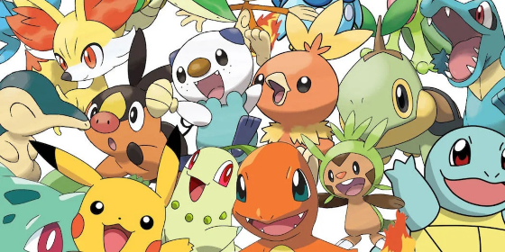

# FDS Pokémon Challenge 2026

Can we predict who wins a Pokémon battle from its first 30 turns? In this [Kaggle challenge](https://www.kaggle.com/competitions/fds-pokemon-battles-prediction-2026), we used Player 1’s starting team, Player 2’s lead, and the events observed through turn 30 to predict the eventual winner. The dataset contains 10,000 labeled battles and 5,000 test battles.

**Team** · Aimilia Kokkinofta, Leonard Thorner, Amirhosein Dalvand, and Meghi Shehu.

## Start here

| Notebook | Approach |
| --- | --- |
| [Aimilia’s final notebook](notebooks/aimilia/final.ipynb) | 274 battle features with a soft vote between logistic regression and histogram gradient boosting |
| [Amirhosein’s final notebook](notebooks/amirhosein/amirs-notebook.ipynb) | Combined soft vote using logistic regression, histogram gradient boosting, and XGBoost |
| [Leonard’s frozen matchup notebook](notebooks/leonard/13_frozen_matchup_submission.ipynb) | Logistic regression with 300 selected features and 16 type-matchup features |

The features summarize HP changes, knockouts, moves, team composition, and type matchups. Player 2’s unrevealed Pokémon remain unknown.

## Explore the code

- [Course starter notebook](notebooks/reference/starter-notebook.ipynb) for the baseline.
- [Official inputs](data/README.md) for the files used in the project.
- [Experiment records](experiments/) for earlier feature and model comparisons.
- [Modelling guide](docs/MODELLING.md) and [shared Python code](src/pokemon_challenge/) for feature extraction, training, and validation.
- [Team workflow](docs/TEAMWORK.md) for contributor instructions.

Run the unit tests from the repository root with `python -m unittest discover -s tests -v`.
