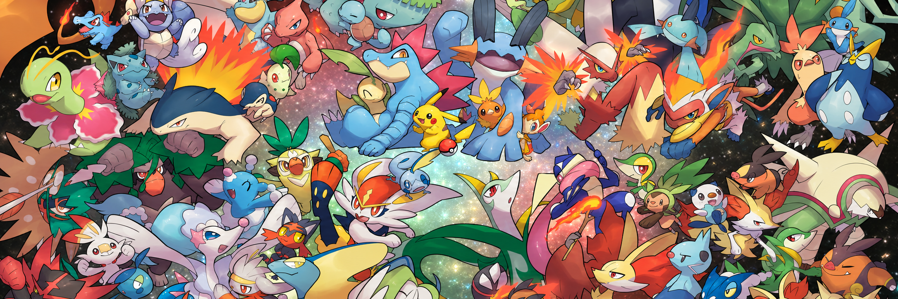

# FDS Pokémon Challenge 2026



Can we predict who wins a Pokémon battle from its first 30 turns? In this [Kaggle challenge](https://www.kaggle.com/competitions/fds-pokemon-battles-prediction-2026), we used Player 1’s starting team, Player 2’s lead, and the events observed through turn 30 to predict the eventual winner. The dataset contains 10,000 labeled battles and 5,000 test battles.

**Team** · Aimilia Kokkinofta, Leonard Thorner, Amirhosein Dalvand, and Meghi Shehu.

**Email** · <kokkinofta.2234529@studenti.uniroma1.it> · <thorner.2351156@studenti.uniroma1.it> · <dalvand.2056639@studenti.uniroma1.it> · <shehu.2057633@studenti.uniroma1.it>

## Start here

We used separate notebooks to develop and evaluate different modelling approaches in parallel.

| Notebook | Approach |
| --- | --- |
| [Aimilia’s final notebook](notebooks/aimilia/final.ipynb) | 274 battle features with a soft vote between logistic regression and histogram gradient boosting |
| [Amirhosein’s final notebook](notebooks/amirhosein/amirs-notebook.ipynb) | Combined soft vote using logistic regression, histogram gradient boosting, and XGBoost |
| [Leonard’s frozen matchup notebook](notebooks/leonard/13_frozen_matchup_submission.ipynb) | Logistic regression with 300 selected features and 16 type-matchup features |

We turned the information available early in each battle into features and tested which ones helped predict the winner. We compared different models and tried combining their predictions to see whether they worked better together.

## Project layout

```text
FDS_Challenge_26/
├── data/raw/                 Official local inputs; ignored by Git
├── notebooks/
│   ├── reference/            Course starter notebook
│   ├── shared/               Agreed analyses maintained by one person per change
│   ├── aimilia/              Aimilia's exploration notebooks
│   ├── leonard/              Leonard's exploration notebooks
│   ├── amirhosein/           Amirhosein's exploration notebooks
│   └── meghi/                Meghi's exploration notebooks
├── src/pokemon_challenge/
│   ├── paths.py              Shared project/data/output path handling
│   ├── data.py               JSONL reader
│   ├── features/             Reusable feature functions
│   ├── models/               Reusable model construction/training
│   └── validation/           Shared splits and evaluation code
├── configs/validation.json   Starting validation settings
├── experiments/<owner>/      One Markdown record per experiment; committed
├── outputs/<owner>/<run>/    Generated files; ignored by Git
├── reports/                  Report sections and final reproduction notes
├── templates/               Personal notebook and experiment templates
├── docs/TEAMWORK.md          Branch, review, and integration workflow
├── pyproject.toml            Installable shared Python package
└── requirements.txt          Project dependencies
```

## Reproduce the predictions

1. Download `train.jsonl`, `test.jsonl`, `sample_submission.csv`, and `type_chart_gen2.csv` from the **Data** tab of the [Kaggle competition](https://www.kaggle.com/competitions/fds-pokemon-battles-prediction-2026) and place them in `data/raw/`.
2. From the repository root, set up the project environment with Python 3.11 or newer.

   ```bash
   python3 -m venv .venv
   source .venv/bin/activate
   python -m pip install -r requirements.txt -e .
   ```

   Use this environment as your notebook kernel. For Leonard’s notebook, use the [frozen runtime](notebooks/leonard/README.md#frozen-runtime-setup). In Amirhosein’s notebook, set `MAKE_SUBMISSION = True` in the final code cell to enable CSV export.

3. When you run a notebook locally, it saves its predictions here.

   | Notebook | Output |
   | --- | --- |
   | Aimilia | `outputs/aimilia/final/submission.csv` |
   | Amirhosein | `outputs/amirhosein/<timestamp>_final/submission.csv` |
   | Leonard | `outputs/leonard/frozen_matchup_submission/submission.csv` |

## Explore the code

- [Course starter notebook](notebooks/reference/starter-notebook.ipynb) for the baseline.
- [Official inputs](data/README.md) for the files used in the project.
- [Experiment records](experiments/) for earlier feature and model comparisons.
- [Modelling guide](docs/MODELLING.md) and [shared Python code](src/pokemon_challenge/) for feature extraction, training, and validation.
- [Team workflow](docs/TEAMWORK.md) for contributor instructions.

Run the unit tests from the repository root with `python -m unittest discover -s tests -v`.
